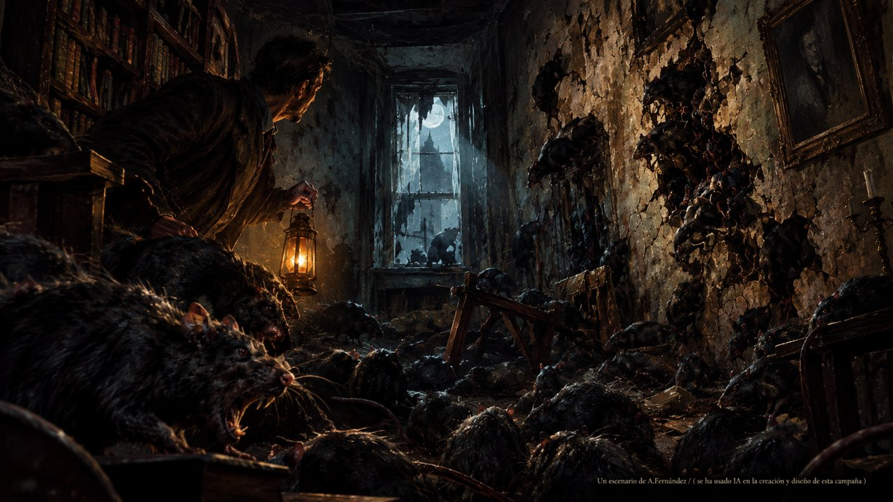

# El Priorato de Exham

**Campaña de cinco escenarios para *Las Mansiones de la Locura* (2.ª edición), para jugar con la app [Valkyrie](https://npbruce.github.io/valkyrie/).** En español, de 1 a 5 investigadores.

Inglaterra, agosto de 1923. El señor Delapore, descendiente de los De la Poer, ha restaurado el Priorato de Exham, la casa que su familia abandonó hace más de tres siglos. Desde entonces, algo corretea dentro de los muros, siempre hacia abajo, y solo él y los gatos parecen oírlo. Vosotros sois las cinco autoridades a las que ha llamado para averiguar qué hay bajo el priorato.

Campaña de cinco escenarios en dos actos, con prólogo, interludios y epílogo. Lo que ocurra cada noche os acompañará en la siguiente: las heridas, la locura, las guineas y todo lo que hayáis descubierto.

> **En fase de prueba.** Pueden aparecer errores. Si encontráis alguno, escribid a **srwilsonmom@gmail.com**.

## Descargas

| | |
|---|---|
| **Reglamento de campaña** | [manuales/Reglamento_de_campana.pdf](manuales/Reglamento_de_campana.pdf). Las reglas para jugar en campaña, con las hojas genéricas para imprimir. |
| **Manual de campaña** | [manuales/El_Priorato_de_Exham_manual_de_campana.pdf](manuales/El_Priorato_de_Exham_manual_de_campana.pdf). Componentes, preparación y reglas propias de esta campaña, con las fichas de ratas para recortar y las hojas para imprimir. Sin revelaciones de la historia. |
| **Relato** | [relato/Las_profundidades_de_Exham.pdf](relato/Las_profundidades_de_Exham.pdf). *Las profundidades de Exham*, relato propio del autor de la campaña, escrito sin pretensiones y solo para dar contexto al acto 2.

Para descargar un PDF, abridlo y pulsad el botón de descarga, arriba a la derecha.

## Qué necesitáis

- **Valkyrie**, con los datos de la app oficial importados.
- *Las Mansiones de la Locura* (2.ª edición) y las expansiones *Más allá del umbral*, *Calles de Arkham*, *Santuario del Crepúsculo*, *La senda de la serpiente* y *Viajes escalofriantes*, además de figuras de la 1.ª edición (kit de conversión y *La llamada de lo salvaje*). La lista completa está en el manual de campaña.
- Imprimir las hojas de investigador y de campaña, y las fichas de ratas.

## Cómo jugar

1. Leed el **reglamento de campaña** y los capítulos 1 a 4 del **manual de campaña**.
2. En Valkyrie, abrid *El Priorato de Exham* desde la lista de escenarios. Es el lanzador: os lleva del prólogo a cada escenario, interludio y epílogo.
3. Pulsad *Nueva campaña* y seguid la app.

## Autoría

Campaña de **Sr. Wilson**. Se ha usado IA en la creación y diseño de la campaña.

Basada en *Las ratas de las paredes*, de H. P. Lovecraft (dominio público), y en *Las profundidades de Exham*, relato propio del autor.

Campaña de aficionado, gratuita y sin ánimo de lucro, sin relación con Fantasy Flight Games. *Las Mansiones de la Locura* es una marca de Fantasy Flight Games. La campaña no incluye arte ni texto de sus juegos: las losetas, monstruos e investigadores los toma Valkyrie de vuestra propia app oficial.

Podéis jugarla y compartirla libremente, pero no venderla.
